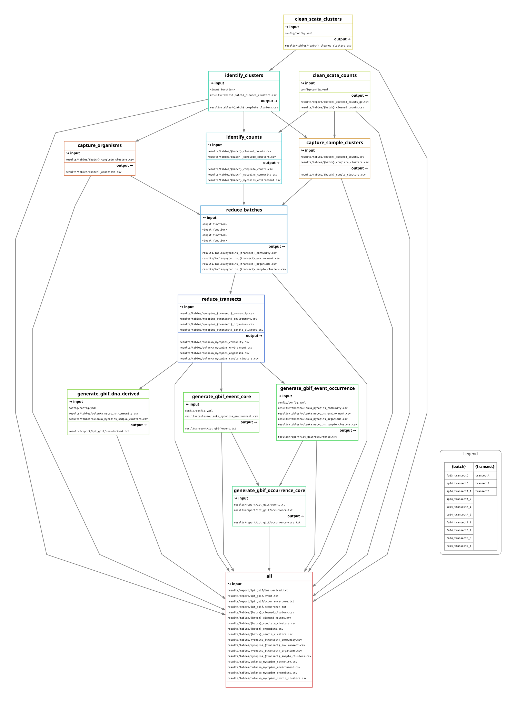

# MycoPins Workflow (Snakemake)

This repository contains a Snakemake workflow for processing fungal DNA metabarcoding outputs from SCATA and BLAST into curated MycoPins-compatible tables then aggregating them by transect and location for for further mycobiome analysis, and finally generating GBIF IPT export files.



## Requirements
The workflow runs on Windows, Mac, and Linux. On Windows, the workflow runs via WSL. The  workflow requires the following software:
* R
* Miniconda

## Environment Setup
### 1) Configure `conda` channels
```{code:bash}
$ conda config --add channels defaults
$ conda config --add channels bioconda
$ conda config --add channels conda-forge
$ conda config --set channel_priority strict
```

### 2) Create and activate an environment
From repository root:

```bash
conda env create -f workflow/envs/mycopins.yaml
conda activate mycopins
```

### 3) Verify toolchain

```bash
snakemake --version
Rscript --version
```

### 4) Clone this repository
```
$ mkdir oulanka
$ cd oulanka
oulanka$ git clone https://github.com/joelclim/mycopins-workflow-snakemake
```

### 5) Metabarcoding Data
Ask for the metabarcoding data from the principal investigator, [Dr. Maria Shumskaya](https://mariashumskaya.com/). The directory structure of the data is as follows:
```
mycopins-workfow-snakemake/
└── data
    ├── blast
    ├── FA23-transectC
    ├── FA24-transectB-1
    ├── FA24-transectB-2
    ├── FA24-transectB-3
    ├── FA24-transectB-4
    ├── FA24-transectB-4w
    ├── SP24-transectA-1
    ├── SP24-transectA-2
    ├── SP24-transectC
    ├── SU24-transectA-1
    ├── SU24-transectA-2
    └── weather
```

## Running the workflow
Run the workflow from the repository root (`mycopins-workflow-snakemake/`)

### Dry run
```bash
snakemake -n --cores 1
```

### Full execution

```bash
snakemake --cores 1
```

Output files are located in results/tables and results/report. Primary logs are written to results/logs/ by rule.

### Generated outputs

The outputs of the workflow are found in the `(repository root)/results/` folder.
The key generated workflow outputs are:
1. IPT-GBIF files for GBIF submission are located in the `(repository root)/results/report/ipt_gbif` folder.
2. Files used for mycobiome analysis are the `(repository root)/results/tables/oulanka_mycopins*.csv` files.


## Output clean up

Snakemake-managed cleanup:

```bash
snakemake --delete-all-output
```

Manual cleanup (entire results directory):

```bash
rm -rf results/*
```

## View Workflow Summary

```bash
snakemake --summary
snakemake --detailed-summary
```

These commands show file status, freshness, and provenance for rule outputs.

### Generate Workflow Report

```bash
snakemake --report report.html
```

## Authors

- Joel Lim
